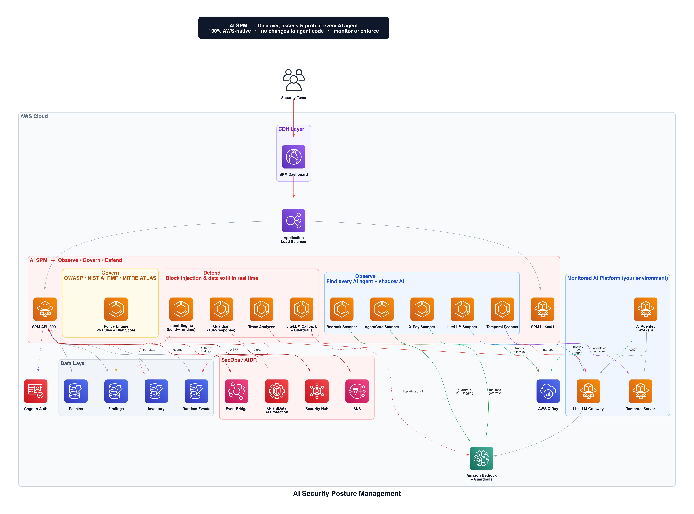

# AI Security Posture Management (AI SPM) on AWS

Discover, assess, and protect the AI agents running in your environment — built
entirely on AWS-native services. AI SPM connects to a
[LiteLLM](https://docs.litellm.ai/) gateway, [Temporal](https://temporal.io/),
and [AWS X-Ray](https://docs.aws.amazon.com/xray/) to give security teams a
single dashboard across three pillars:

- **Observe** — continuous discovery and inventory of AI agents (LiteLLM models
  and keys, Temporal workflows, Bedrock agents, SageMaker endpoints, AI Lambdas),
  enriched with X-Ray behavioral baselines and a live service-dependency graph.
- **Govern** — a policy engine that evaluates agent configuration and
  trace-derived behavior against 10 built-in rules mapped to **OWASP LLM Top 10**,
  **NIST AI RMF**, and **MITRE ATLAS**.
- **Defend** — runtime threat detection (prompt injection, data exfiltration,
  memory poisoning, rate limiting, anomalous topology) via a LiteLLM callback and
  X-Ray trace analysis, with configurable **monitor** or **enforce** (inline
  blocking) modes.



> **Sample code, not production-ready.** This repository is intended to
> demonstrate an architecture and accelerate your own build. Review the
> [Security](#security) section and harden it before any production use.

## Featured use case — Group Sales & Event Management with AI Planning (Hospitality)

Hotels, resorts, and convention venues increasingly run **group sales and event
management** with multi-agent AI: an inbound RFP for a conference, wedding, or
corporate offsite kicks off cooperating agents that qualify the lead, check space
and room availability, build menus, draft the banquet event order, price the
package, and generate a proposal — pulling from the PMS, CRM, catering, and
payment systems.

These agents are autonomous, **highly privileged** (guest PII, negotiated
pricing, contracts, payments), and ingest **untrusted inbound content** (RFP
emails and documents) — the precise risk profile AI SPM is built to **Observe,
Govern, and Defend**. A malicious instruction hidden in an RFP, an over-permissive
sales key, or a planning agent that suddenly reaches a payment API are all
detectable here.

A ready-to-run baseline is included so you can see this end to end:

```bash
export SPM_CONFIG_FILE="$(pwd)/config/hospitality-group-sales.example.json"
```

- **Config:** [`config/hospitality-group-sales.example.json`](config/hospitality-group-sales.example.json)
  (9 group-sales/event workflows + their allowed dependencies)
- **Full write-up:** [`docs/use-cases/group-sales-event-management.md`](docs/use-cases/group-sales-event-management.md)

## Architecture

AI SPM deploys as an **extension** to an existing AWS environment. It does not
create a VPC, ECS cluster, or ALB — you provide those as parameters and AI SPM
adds its own ECS services, DynamoDB tables, IAM role, ALB listener, and
CloudFront distribution.

| Component | Service | Purpose |
|-----------|---------|---------|
| SPM API | ECS Fargate (FastAPI) | Discovery, policy evaluation, runtime monitoring, REST API |
| SPM UI | ECS Fargate (Next.js) | Security dashboard |
| Data | DynamoDB (4 tables) | Inventory, findings, policies, runtime events (TTL) |
| Auth | Amazon Cognito | Dashboard authentication |
| Edge | CloudFront + ALB | Dashboard delivery |
| Telemetry | AWS X-Ray + ADOT | Trace ingestion and behavioral baselines |

See [docs/ARCHITECTURE.md](docs/ARCHITECTURE.md) for details and data flows.

## Prerequisites

This is an extension, so it requires an existing platform to monitor:

- An **AWS account** with permissions to create DynamoDB, ECS, IAM, ELB, and
  CloudFront resources.
- An existing **VPC** with private subnets (NAT gateway or VPC endpoints for
  outbound AWS API access).
- An existing **ECS Fargate cluster**, **Application Load Balancer**, an ECS
  **task execution role**, an ECS **security group**, and a **Cloud Map**
  private DNS namespace.
- A **LiteLLM** proxy and (optionally) a **Temporal** server to discover.
- **Amazon Bedrock** model access for the optional semantic injection classifier.
- An **Amazon Cognito** user pool + app client for dashboard auth.
- Tooling: `aws` CLI, `finch` or `docker`, Python 3.11+, Node.js 20+.

## Repository layout

```
.
├── spm/                       # Python backend (FastAPI)
│   ├── api/main.py            # REST API + transparent LLM proxy
│   ├── core/                  # db, models, auth (Cognito), tracing, config
│   ├── scanner/               # LiteLLM / Temporal / X-Ray / AWS discovery
│   ├── engine/policy_engine.py# 10 Govern rules
│   └── defender/              # runtime monitoring, detectors, correlation
├── spm-ui/                    # Next.js dashboard
├── infra/
│   ├── 01-spm-platform.yaml   # tables, IAM, ECS services, target groups
│   └── 02-spm-cdn.yaml        # ALB listener + CloudFront
├── config/
│   ├── spm-config.example.json            # KNOWN_WORKFLOWS / EXPECTED_DEPS (generic)
│   ├── hospitality-group-sales.example.json # Featured hospitality use-case baseline
│   └── litellm-callback.example.yaml      # how to register the Defend callback
├── docs/
│   ├── ARCHITECTURE.md
│   └── use-cases/group-sales-event-management.md  # Featured use case
├── Dockerfile.spm-api
├── deploy.sh
├── generate_architecture_diagram.py
└── .env.example
```

## Quick start

### 1. Run the backend locally

```bash
python -m venv .venv && source .venv/bin/activate
pip install -e .

# Point at your platform (DynamoDB tables must exist, or use a local mock)
export AWS_REGION=us-east-1
export LITELLM_URL=http://localhost:4000
export LITELLM_KEY=your-litellm-admin-key
export TEMPORAL_ADDRESS=localhost:7233
# COGNITO_POOL_ID unset => auth disabled (local only)

uvicorn spm.api.main:app --reload --port 8001
# Health check:
curl localhost:8001/spm/health
```

### 2. Run the dashboard locally

```bash
cd spm-ui
npm install
export NEXT_PUBLIC_API_URL=http://localhost:8001
export NEXT_PUBLIC_COGNITO_POOL_ID=...   # optional for local
export NEXT_PUBLIC_COGNITO_CLIENT_ID=...
npm run dev   # http://localhost:3001
```

### 3. Deploy to AWS

```bash
cp .env.example .env
# edit .env with your VPC, subnets, cluster, ALB, Cognito, LiteLLM, etc.
source .env
./deploy.sh
```

`deploy.sh` builds and pushes the two images to ECR and deploys both
CloudFormation stacks. After it completes:

1. Allow inbound on the SPM listener port (default `8090`) on your ALB security
   group from the CloudFront origin-facing managed prefix list.
2. Register the Defend callback in your LiteLLM config (see
   [`config/litellm-callback.example.yaml`](config/litellm-callback.example.yaml)).

## Configuration

All configuration is via environment variables (12-factor). Key ones:

| Variable | Default | Description |
|----------|---------|-------------|
| `ENVIRONMENT_NAME` | `ai-spm` | Prefix for DynamoDB table names |
| `LITELLM_URL` | `http://localhost:4000` | LiteLLM proxy base URL |
| `LITELLM_KEY` | _(empty)_ | LiteLLM admin key (use Secrets Manager in prod) |
| `TEMPORAL_ADDRESS` | `localhost:7233` | Temporal frontend address |
| `AWS_REGION` | `us-east-1` | Region for boto3 clients |
| `COGNITO_POOL_ID` / `COGNITO_CLIENT_ID` | _(empty)_ | Dashboard auth (empty = disabled) |
| `SPM_CONFIG_FILE` | _(unset)_ | Path to JSON with `known_workflows` / `expected_dependencies` |
| `SPM_MONITORED_SERVICES` | _(empty)_ | Comma-separated service-name filter for new-dependency alerts |
| `SPM_CLASSIFIER_MODEL_ID` | `us.anthropic.claude-3-5-haiku-20241022-v1:0` | Bedrock model for semantic injection detection |
| `SPM_POLL_INTERVAL_SEC` | `10` | Runtime monitor poll interval |
| `SPM_PLUGINS` | _(empty)_ | Comma-separated import paths of third-party plugin modules (detectors/rules/scanners/sinks) |
| `SPM_BEDROCK_GUARDRAIL_ID` / `SPM_BEDROCK_GUARDRAIL_VERSION` | _(empty)_ / `DRAFT` | Enable Amazon Bedrock Guardrails enforcement in the proxy |
| `SPM_APPROVED_MODELS` | _(empty)_ | Comma-separated model allowlist for the `unapproved_model` rule |
| `SPM_REQUIRE_GUARDRAIL` | _(empty)_ | Set `true` to activate the `missing_guardrail_association` rule |
| `SPM_SECURITY_HUB_ENABLED` | _(empty)_ | Set `true` to export findings to AWS Security Hub (ASFF) |
| `SPM_GUARDDUTY_ENABLED` | _(empty)_ | Set `true` to ingest GuardDuty AI Protection findings |
| `SPM_ANALYZE_IDENTITY` | _(empty)_ | Set `true` to analyze agent execution-role privilege (ASI03; needs IAM read) |
| `SPM_GUARDIAN_MODE` | `off` | Guardian autonomous response: `off` / `recommend` / `auto` |
| `SPM_INTENT_LLM` | _(empty)_ | Set `true` to enable the Bedrock intent-alignment classifier |
| `SPM_INTENT_BASELINE_FACTOR` | `3.0` | Token-volume multiplier over baseline that flags behavioral drift |
| `SPM_SNS_TOPIC_ARN` | _(empty)_ | SNS topic for high-severity runtime alerts |
| `SPM_EVENT_BUS_NAME` | _(empty)_ | EventBridge bus for high-severity runtime events |

Environment-specific knowledge (which workflows you expect and their allowed
downstream dependencies) is optional and supplied via `SPM_CONFIG_FILE`. See
[`config/spm-config.example.json`](config/spm-config.example.json). Defaults are
empty so discovery works against any platform without configuration.

## Govern rules

Rules are registered plugins (see [Extensibility](#extensibility)) mapped to the
**OWASP LLM Top 10 (2025)**, **OWASP Agentic AI threats**, **NIST AI RMF**, and
**MITRE ATLAS**.

| Rule | Severity | Frameworks |
|------|----------|-----------|
| `overprivileged_key` | High | OWASP LLM06, Agentic T6, NIST |
| `unrestricted_model_access` | High | OWASP LLM06, MITRE, NIST |
| `missing_guardrails` | Medium | OWASP LLM10, NIST |
| `excessive_spend` | Medium | OWASP LLM10, NIST |
| `stale_agent` | Low | NIST |
| `high_retry_rate` | High | OWASP LLM10, NIST |
| `latency_anomaly` | Medium | MITRE |
| `excessive_llm_calls` | Medium | OWASP LLM06, Agentic T6, MITRE |
| `missing_trace_propagation` | Low | NIST |
| `unexpected_dependency` | High | Agentic T2, MITRE, OWASP LLM06 |
| `jailbreak_activity` | High | OWASP LLM01, Agentic T1, MITRE |
| `sensitive_data_exposure` | Critical | OWASP LLM02, MITRE, NIST |
| `insecure_output_handling` | High | OWASP LLM05, MITRE |
| `excessive_agency` | High | OWASP LLM06, Agentic T6, MITRE |
| `unapproved_model` | Medium | NIST, Agentic T15 |
| `missing_guardrail_association` | Medium | OWASP LLM01, NIST |

Plus **5 Amazon Bedrock posture rules** (guardrail strength/PII, knowledge-base
encryption, model-invocation logging, agent guardrail association) and an
**agent identity / NHI** rule (`excessive_agent_privilege`, ASI03) — see
[docs/bedrock-security.md](docs/bedrock-security.md). Inspect all loaded rules at
`GET /spm/api/plugins`.

## Runtime detectors (Defend)

Detectors are also plugins. Built-ins: regex + Bedrock-semantic **prompt
injection**, **jailbreak**, **system-prompt extraction**, **memory poisoning**,
**rate limiting**, **PII/secret exfiltration**, **insecure output handling**,
**MCP/tool usage**, **excessive agency**, and **Amazon Bedrock Guardrails**
(content filters, denied topics, PII redaction). Run in **monitor** or
**enforce** (inline blocking) mode.

Optionally layer a best-of-breed **OSS detection ensemble** (no vendor lock-in)
with `pip install "ai-spm[security]"`: ProtectAI **LLM Guard** (ML
prompt-injection + secrets) and Microsoft **Presidio** (PII). These register
automatically when installed and no-op when not.

### Intent-based detection + build-to-runtime correlation

The `intent_alignment` detector infers whether an agent's **runtime behavior**
matches how it was **built/configured**: it correlates the model, tools, and
token usage seen at runtime against the agent's inventory record (sanctioned
models, expected dependencies, behavioral baseline) and tracks per-session
**intent/behavioral drift** (new models/tools appearing mid-session). An optional
Bedrock classifier (`SPM_INTENT_LLM=true`) judges whether an agent's action
summary aligns with its declared purpose.

### Guardian — autonomous graduated response

The Guardian orchestrator (`POST /spm/api/guardian/run`, gated by
`SPM_GUARDIAN_MODE` = `off` | `recommend` | `auto`) takes recent high/critical
events and applies a **proportional** response — alert → block → contain
(quarantine workflow / revoke model access) — executing via the existing
remediations and writing an audited `guardian_action` trail.

## Deep Amazon Bedrock security

A dedicated Bedrock scanner discovers **Guardrails** (filter strength, PII,
denied topics), **Knowledge Bases** (KMS encryption), **model-invocation
logging**, and **Bedrock Agents**, plus a **Bedrock AgentCore** scanner
(runtimes, MCP gateways, memories) — with Bedrock-specific Govern rules.
Full details: [docs/bedrock-security.md](docs/bedrock-security.md).

## Measure your defenses (red-team benchmark)

`POST /spm/api/redteam/run` runs a curated attack corpus (injection, jailbreak,
extraction, exfiltration, insecure output) plus benign controls against your
**live** detector stack and returns an objective **defense-effectiveness score**
— detection rate, false-positive rate, and per-category breakdown. Use it to
prove (not just claim) coverage before and after enabling Guardrails / the OSS
ensemble.

## AIDR integrations

High-severity findings and runtime events fan out to pluggable sinks for AI
Detection & Response: **AWS Security Hub** (ASFF `BatchImportFindings`),
**Amazon SNS**, and **Amazon EventBridge**. AI SPM also **ingests Amazon
GuardDuty AI Protection** findings (guardrail removal, disabled invocation
logging, anomalous Bedrock usage) via `POST /spm/api/integrations/guardduty/ingest`
(`SPM_GUARDDUTY_ENABLED=true`), and can analyze **agent execution-role privilege**
for non-human-identity risk (ASI03, `SPM_ANALYZE_IDENTITY=true`).

Standards alignment: rules are tagged to **OWASP LLM Top 10 (2025)**, the
**OWASP Top 10 for Agentic Applications (ASI01–ASI10, Dec 2025)**, **NIST AI
RMF**, **MITRE ATLAS**, and mapped to the **AWS SRA for AI**
([docs/bedrock-security.md](docs/bedrock-security.md)).

## Extensibility

AI SPM is extensible by design. Four decorator-based registries — **detectors**
(Defend), **rules** (Govern), **scanners** (Observe), and **sinks** (AIDR) — let
you add capabilities without modifying core code. Drop a module with your
decorated function anywhere importable and point `SPM_PLUGINS` at it:

```python
from spm.core.registry import detector, Detection

@detector("acme.secret_scanner", phases=("post",))
def scan_secrets(ctx):
    if "BEGIN RSA PRIVATE KEY" in ctx.response_text:
        return [Detection("private_key_leak", "critical", {"model": ctx.model}, block=True)]
    return []
```

```bash
SPM_PLUGINS="acme.spm_plugins" uvicorn spm.api.main:app
```

Inspect everything that's loaded at `GET /spm/api/plugins`. Full guide:
[docs/extending.md](docs/extending.md). How it stacks up against commercial AI
agent security platforms: [docs/comparison.md](docs/comparison.md).

## Testing

```bash
pip install -e ".[dev]"
pytest -q
```

The suite covers the plugin registry, the detection logic against the red-team
corpus (asserts ≥80% recall and 0 false positives on benign controls), the risk
scoring engine, and `db.py` against moto-mocked DynamoDB. CI runs on every push
(see `.github/workflows/tests.yml`).

## Security

- **Authentication:** Set `COGNITO_POOL_ID`/`COGNITO_CLIENT_ID`. With them
  unset, the API treats every caller as anonymous — for local development only.
- **Secrets:** Never hardcode the LiteLLM master key. The provided CloudFormation
  accepts it as a `NoEcho` parameter for convenience; for production, store it in
  **AWS Secrets Manager** and inject it via the task definition's `Secrets`.
- **CORS:** The API uses a permissive `*` CORS policy for the sample. Restrict it
  to your dashboard origin before production use.
- **Enforce mode:** Inline blocking (`/spm/api/defender/mode` = `enforce`) can
  reject live LLM traffic. Validate detection rules in `monitor` mode first.
- **Least privilege:** Review the IAM policy in `infra/01-spm-platform.yaml` and
  scope `Resource: '*'` entries (X-Ray, discovery) to your needs.

See [CONTRIBUTING.md](CONTRIBUTING.md#security-issue-notifications) for how to
report security issues.

## Cleanup

```bash
aws cloudformation delete-stack --stack-name ai-spm-cdn --region "$AWS_REGION"
aws cloudformation delete-stack --stack-name ai-spm-platform --region "$AWS_REGION"
# Optionally delete the ECR repositories: ai-spm-spm-api, ai-spm-spm-ui
```

## License

This library is licensed under the MIT-0 License. See the [LICENSE](LICENSE) file.
